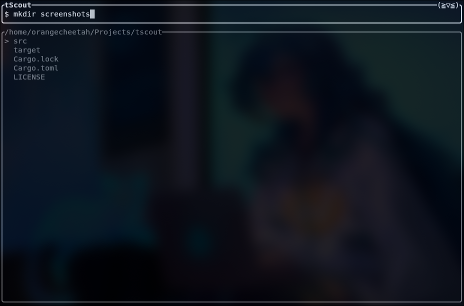
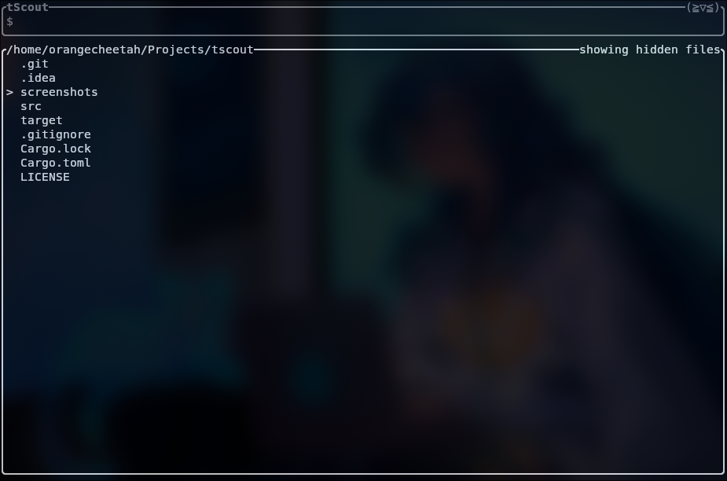
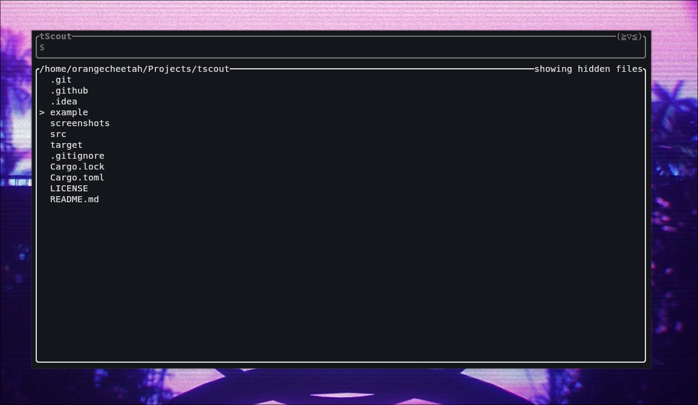

# tScout

> [!IMPORTANT]
> Make sure your terminal has a nerd font installed! Otherwise, some icons will not work.

> [!WARNING]
> Opening TUI applications within tScout is not reliable. Use `kitty nvim <file>` or whatever makes sense for your setup instead.

## Features
* Navigate folders
* Show/hide hidden files
* Run commands
* Open files in your default editor *(see warning above)*

More to come soon!

## Screenshots

